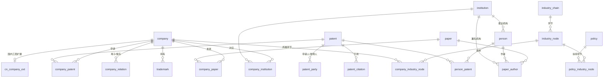

# qzd_db —— 企知道类「企业 / 专利 / 论文 / 政策」大数据平台 · 样本数据库

本仓库通过 Git LFS 发布两个完整包（仓库里不保留分片）：

- `qzd_db.zip`（1,760,545,664 字节，sha256 `1d4395808f93724a42c0c3dcb2af8b3711bf3be110b91fb6e3ba89a9f4fcb619`）：PostgreSQL dump、脚本，以及除 `company.csv.gz` 以外的 CSV
- `qzd_db_company_csv.zip`（986,819,191 字节，sha256 `1c4728124cc159d6ff469e2a0b10898c34c3ce03c8da3cd6608681874a419c06`）：仅 `export/csv/company.csv.gz`

包内是可恢复的 PostgreSQL 17 数据库：统一 schema，以及可重复执行的下载/入库脚本。
企业侧包含 GLEIF 与英国 Companies House 公开数据（条数与 v3 一致），并补充苏州相关公开名单；论文、专利为样本；国内政策来自中国政府网政策库与部分部委/省级栏目。
只使用合法、免费、公开的数据。

## 当前发布包

| 数据 | 条数 |
|---|---|
| 企业 | 9,221,952 |
| 苏州（city） | 26,150 |
| company_list | 45,720 |
| GLEIF | 3,463,900（与 v3 一致） |
| UK Companies House | 5,704,711（与 v3 一致） |
| 专利 | 723,336（与 v3 一致） |
| 论文 | 10,000（与 v3 一致） |
| 机构 | 13,633（与 v3 一致） |
| 人员 | 约 74,787（与 v3 一致） |
| 政策 | 27,703 |
| 高企 2025 | 5,655 |
| 专精特新 2025 | 2,108 |

### 下载

仓库现有两个 Git LFS 文件，没有分片。克隆后拉取 LFS 对象：

```bash
git lfs install
git clone https://github.com/ljyzmy/shuju.git
cd shuju
git lfs pull
```

只拉取这两个包：

```bash
git lfs pull --include="qzd_db.zip,qzd_db_company_csv.zip"
```

`qzd_db.zip` 解压后得到 dump、脚本和其余 CSV。`company.csv.gz` 在 `qzd_db_company_csv.zip` 里，解压后放到 `export/csv/company.csv.gz`，即可与 dump 一起使用。

## 1. 目录
```
qzd_db/
├── schema.sql                 # 统一表结构 + 索引（可重复执行）
├── examples.sql               # 示例跨表查询
├── run_all.sh                 # 一键：建表→下载→入库→关联→导出
├── scripts/
│   ├── common.py              # 数据库连接 / upsert
│   ├── fetch_openalex.py      # 论文/作者/机构（OpenAlex API）
│   ├── fetch_patents.py       # 专利（Google Patents Public Data 镜像 parquet，HTTP Range 按需读取）
│   ├── fetch_companies.py     # 企业（GLEIF LEI API + UK Companies House 批量文件）
│   ├── enrich_link_seeds.py   # 用专利申请人/企业型机构名去 GLEIF 补查法人，便于样本间关联
│   ├── crawl_policy_govcn.py  # 中国政府网 国务院文件+部门文件 全量（断点续传、去重、限速、robots）
│   ├── crawl_policy_sites.py  # 省级/部委政策栏目 通用爬虫（配置 SITES 即可扩展）
│   ├── load_policy.py         # 爬虫状态库 → PostgreSQL policy 表（自动打标签）
│   ├── link_entities.py       # 实体关联（名称规范化精确 + pg_trgm 模糊）
│   └── export.sh              # pg_dump + 每表 CSV.gz
├── data/raw/                  # 原始下载（jsonl / zip）
├── data/state/policy_crawl.sqlite  # 政策爬虫状态库（含全文，可单独使用）
└── export/                    # qzd.dump（pg_restore 用）、csv/*.csv.gz
                               # company.csv.gz 在 qzd_db_company_csv.zip，不在 qzd_db.zip
```

## 2. 结构图

- 统一 ID：企业 `company(source, source_id)` 唯一（LEI / 英国公司号 / 统一社会信用代码）；论文/作者/机构用 OpenAlex ID；专利用公开号（如 `CN-123456789-A`）。
- 关联表都带 `match_method` + `confidence`，以后换成更强的实体消歧可直接覆盖。
- 索引：名称/标题 `pg_trgm` 模糊、IPC GIN、日期、发文机关/地区、政策全文 `to_tsvector`。中文全文检索建议上线时装 zhparser 或接 Elasticsearch/OpenSearch。

## 3. 数据源、样本条数、全量规模、许可
| 类别 | 数据源 | 本库样本 | 全量规模与获取方式 | 许可 |
|---|---|---|---|---|
| 论文 | OpenAlex API：中国机构参与的 2024 年起 works | 10,000；机构 13,633；人员约 74,787 | 约 2.7 亿 works；snapshot `aws s3 sync s3://openalex openalex-snapshot --no-sign-request`（约 300GB gz）。API 免 key 只能 page 分页且只到 1 万条，每日 0.1 美元额度；更大量需免费 API key（环境变量 `OPENALEX_API_KEY`） | CC0 |
| 专利 | Google Patents Public Data（IFI CLAIMS/Google）的 HuggingFace parquet 镜像 `labofsahil/patents-publications-dataset` | 723,336 件（CN 约 716,282） | 1.6 亿余件公开文本；BigQuery `patents-publications.patents.publications`，或镜像全部 parquet（每个约 13.6GB，共数 TB）。PatentsView 已迁入 USPTO ODP（2026-06-18 起要 USPTO.gov 账号+MFA+API key）；EPO OPS、Lens 要免费注册拿 token | CC BY 4.0（Google Patents Public Data） |
| 企业（全球） | GLEIF Golden Copy / LEI | 3,463,900 | Golden Copy 每日全量 CSV：https://www.gleif.org/en/lei-data/gleif-golden-copy ，另有关系文件 RR（母子公司） | CC0 |
| 企业（英国） | Companies House BasicCompanyData | 5,704,711 | 7 个分卷：https://download.companieshouse.gov.uk/en_output.html | OGL v3 |
| 企业（国内工商） | 公开名单、LEI 与相关公开来源 | 中国约 136,279 | **没有合法的公开批量包**覆盖全部工商主体，全量需要商业采购：企查查/天眼查/启信宝开放平台 API，或各地数据交易所。国家企业信用信息公示系统只能逐条查，禁止批量爬 | 按采购合同 |
| 商标 | —— | 空表 trademark | 国内：商标局「商标网上查询」逐条查，批量需商业采购；美国：USPTO 商标 bulk（ODP，要 key） | — |
| 产业链 | —— | 空表 industry_chain / industry_node | 需自建：人工梳理 + IPC/关键词映射 | 自有 |
| 政策 | 中国政府网政策文件库 + 部委/省级政策栏目（见第 4 节） | 见第 4 节 | 见第 4 节 | 政府信息公开；保留原文 URL 并注明来源 |

## 4. 国内政策（全量抓取）
字段：标题、文号、发文机关、层级、地区、发布日期、成文日期、主题分类、全文、附件链接、原文 URL、索引号、自动标签（高企/专精特新/小巨人/研发费用/知识产权等）。

规则：先读 robots.txt（gov.cn 只禁止 /2016*/、/premier/ 等，政策库路径允许）；每个进程每次请求间隔 1–2 秒；状态存在 `data/state/policy_crawl.sqlite`，URL 主键去重，列表页记录到第几页、详情页状态 `detail_ok`（1 成功 / -1 失败 / 0 待抓），中断后重跑会从断点继续。

### 本库政策统计（抓取完成）
- 合计详情成功 **27703** 条。v5 在原有站点之外新增江苏政策 **160** 条；下表仍是此前各站点明细（成功合计 27477）。
| 站点 | 成功 | 失败 | 合计 |
|---|---|---|---|
| www.beijing.gov.cn | 1099 | 0 | 1099 |
| www.cq.gov.cn | 1000 | 1 | 1001 |
| www.gd.gov.cn | 1246 | 0 | 1246 |
| www.gov.cn | 19023 | 0 | 19023 |
| www.mof.gov.cn | 493 | 2 | 495 |
| www.most.gov.cn | 9 | 0 | 9 |
| www.ndrc.gov.cn | 918 | 0 | 918 |
| www.sc.gov.cn | 50 | 0 | 50 |
| www.shanghai.gov.cn | 2639 | 0 | 2639 |
| www.tj.gov.cn | 1000 | 0 | 1000 |

已覆盖：中国政府网国务院文件库 + 部门文件库（全量）；北京市、天津市、上海市、重庆市、广东省、四川省；科技部、发改委（通知/规范性文件/令）、财政部。

未能覆盖或受阻：河北/山西/辽宁/吉林/黑龙江/安徽/福建/江西/河南/湖北/湖南/广西/海南/贵州/云南/陕西/甘肃/内蒙古等（403/404/超时/WAF/无稳定列表页）；工信部/税务总局列表页无可用文章链接或反爬。脚本已保留扩展位，后续可加。


扩展：在 `crawl_policy_sites.py` 的 `SITES` 里加一行（站点名、层级、地区、列表首页、分页模板、起始页号、文章链接正则）就行。详情页解析优先读 TRS 系统的 meta 标签（ArticleTitle/PubDate/ContentSource/ColumnName），读不到再按常见正文容器提取。

## 5. 运行
```bash
# PostgreSQL 17（本机已装，库 qzd / 用户 box / 密码 qzd）
export QZD_DSN="host=localhost dbname=qzd user=box password=qzd"
./run_all.sh                       # 全流程，可重复执行
# 只恢复数据：
createdb qzd && pg_restore -d qzd export/qzd.dump
# 扩到全量：调大环境变量 N_WORKS / N_INST / N_CN / N_OTHER / ROW_GROUPS / N_GLEIF / N_UK，
# 或者改成直接下载 snapshot（OpenAlex S3、GLEIF Golden Copy、Companies House 全部分卷）后批量 COPY。
```

## 6. 示例查询（examples.sql，已验证）
```sql
-- 企业→专利：GLEIF 法人里专利最多的
SELECT c.name, c.lei, count(*) FROM company c JOIN company_patent USING(company_id) GROUP BY 1,2 ORDER BY 3 DESC LIMIT 10;
-- 中国申请人 IPC 小类分布
SELECT left(i,4), count(DISTINCT p.patent_id) FROM patent p JOIN patent_party pp ON pp.patent_id=p.patent_id
 AND pp.role='assignee' AND pp.country='CN', unnest(p.ipc) i GROUP BY 1 ORDER BY 2 DESC LIMIT 10;
-- 机构→论文→专家（找专家）
SELECT i.name, count(DISTINCT pa.paper_id), max(pe.h_index) FROM paper_author pa JOIN institution i USING(institution_id)
 LEFT JOIN person pe USING(person_id) WHERE i.country='CN' GROUP BY 1 ORDER BY 2 DESC LIMIT 10;
-- 政策：近两年涉及专精特新/高企的政策，按发文机关统计
SELECT issuer, count(*) FROM policy WHERE pub_date>=current_date-730 AND tags && ARRAY['专精特新','高新技术企业'] GROUP BY 1 ORDER BY 2 DESC;
-- 一个主题同时查政策、专利、论文（产业情报雏形）
```
验证结果见 `export/validation_output.txt`。

## 7. 已知限制
- 三类样本是分别抽的，彼此重叠少，所以 company_patent / company_institution 关联条数少（规则匹配，Google 专利的申请人名是缩写形式，比如 HUAWEI TECH CO LTD）。全量后这些关联会自然变多；上线建议做专门的企业名称消歧（中英文名、曾用名、统一社会信用代码）。
- 政策全文是从 HTML 提取的，个别站点版式特殊时正文会混进导航文字；附件只存链接，不下载附件本身。

## 公司资料结构化提炼

见 [extraction/](extraction/)。
